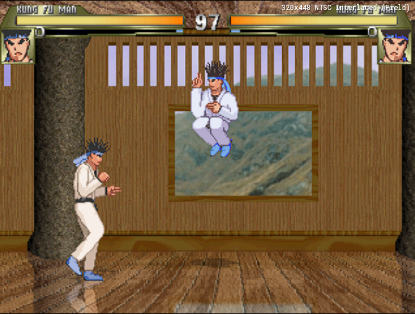
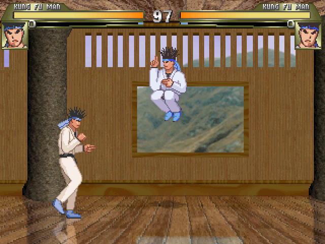
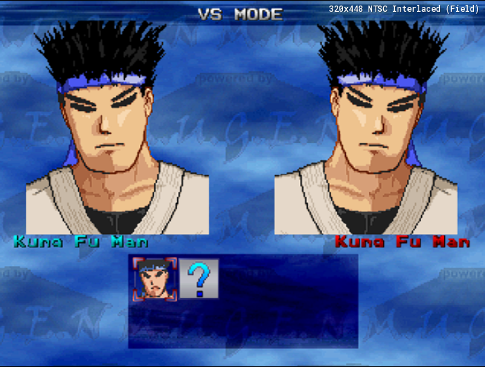
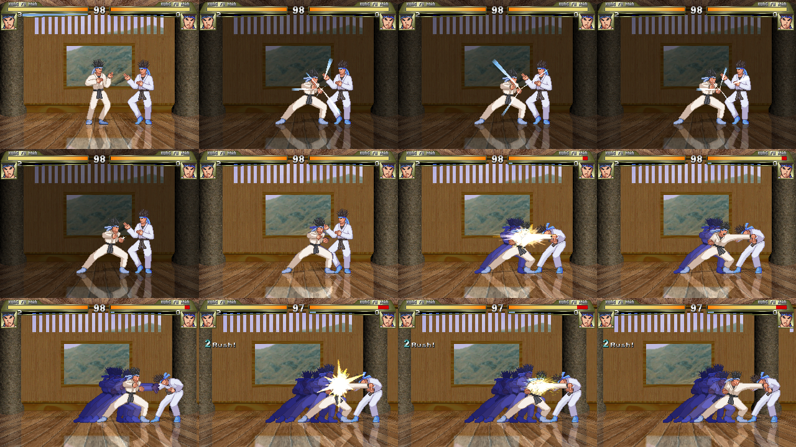

# RustGen — M.U.G.E.N en PlayStation 2, en Rust

Un motor de peleas compatible con los archivos de M.U.G.E.N, escrito en Rust con la
biblioteca estándar y compilado para PlayStation 2 con
[PS2Rust](https://github.com/mostazaniikkkk/PS2Rust). Carga a Kung Fu Man tal como viene
con MUGEN (sprites, animaciones, comandos, estados y sonidos, sin convertir nada) y lo
pone a pelear contra sí mismo a 60 cuadros por segundo.

| PlayStation 2 (PCSX2) | El mismo tick en el PC |
|---|---|
|  |  |

Alrededor de la pelea corre un screenpack de MUGEN (`system.def`): menú de título,
selección de personaje y escenario, pantalla de versus, pantalla de victoria y
storyboards.





*Triple Kung Fu Palm, un cuadro de cada ocho: superpausa con el fondo oscurecido, estela,
chispas de golpe y contador de combo (rasterizador de PC).*

## Jugar

Requisitos: [PS2Rust](https://github.com/mostazaniikkkk/PS2Rust) en `D:/Proyectos/PS2Rust`
y PCSX2 con BIOS y la opción *Host Filesystem* activada. Las dos rutas están en
[.cargo/config.toml](.cargo/config.toml) y en [ps2/Cargo.toml](ps2/Cargo.toml): cámbialas
por las tuyas.

> **Aviso:** el programa de PS2 necesita dos funciones de la std de PS2Rust
> (`std::os::ps2::SifRpcClient` y `std::os::ps2::reset_iop`) que todavía no están en el
> repositorio público de PS2Rust. Hasta que se publiquen, sólo compilan el motor y la
> herramienta de PC (`cargo build`, `cargo test`).

```
.\run-ps2.ps1          # PowerShell
sh run-ps2.sh          # Git Bash
```

Compila el juego, con la carpeta `game/` empaquetada dentro del ELF, y abre PCSX2.

| Mando | Acción |
|---|---|
| Cruceta | Moverse, saltar, agacharse; atrás para cubrirse |
| Cuadrado / Triángulo | Puñetazo débil / fuerte (x / y) |
| Equis / Círculo | Patada débil / fuerte (a / b) |
| R1 / R2 | Botones z / c (Kung Fu Man no los usa) |
| START | Burla (s) |
| SELECT | Mostrar las cajas de colisión |
| START + SELECT (medio segundo) | Salir de la pelea al título |

En los menús: la cruceta mueve, cualquier botón acepta y SELECT vuelve atrás. En la
selección, el botón con que eliges al personaje decide su paleta (cuadrado, triángulo,
R1, equis, círculo y R2 son las paletas 1 a 6).

Sin mando en el puerto 2, al segundo jugador lo lleva la máquina y en VS MODE el
jugador 1 elige a los dos. Los movimientos de Kung Fu Man están en
[game/chars/kfm/readme.txt](game/chars/kfm/readme.txt).

### En una consola: Free McBoot o disco

```
.\dist.ps1             # o: sh dist.sh
```

Deja dos archivos en `dist/`:

| Archivo | Uso | Dónde van los datos |
|---|---|---|
| `mugen-ps2.elf` | Cópialo a un USB o a la tarjeta de memoria y lánzalo con uLaunchELF desde Free McBoot. No necesita ningún otro archivo | Dentro del ELF |
| `mugen-ps2.iso` | Imagen de disco: para un emulador, un cargador (OPL) o para grabarla | En `GAME.PAK`, en el disco |

El ELF suelto no lee nada del dispositivo desde el que se lanza, así que da igual que sea
USB o tarjeta de memoria. La imagen de disco lee de `GAME.PAK` sólo lo que necesita la
pantalla o la pelea en curso. Los dos reinician el procesador de E/S al arrancar, para
partir de los módulos de la BIOS sea cual sea el programa que los lanzó.

Cambiar personajes, escenarios o `ps2.cfg` exige volver a generar los archivos: los datos
se empaquetan al compilar.

### Personajes grandes

Un archivo de sprites pesa varias veces más descomprimido que en disco (Kung Fu Man:
200 KB en disco, 1,6 MB en memoria). Según su tamaño, un SFF se trata de tres formas:

| Tamaño | Qué se hace |
|---|---|
| Pequeño | Se descomprime entero al cargar |
| Descomprimido pasa del umbral (4 MB) | Se queda comprimido en memoria; cada sprite se descomprime la primera vez que se dibuja |
| El propio archivo pasa del umbral (SFF v2) | No se lee entero: sólo su índice y sus paletas. Los datos de cada sprite se leen del disco cuando hacen falta |

Los sprites ya descomprimidos se guardan en una caché de 1 MB por archivo, que suelta los
que llevan más tiempo sin usarse. El umbral y la caché se cambian en `game/ps2.cfg`
(`stream` y `stream.cache`, en KB). Los sonidos siguen la misma idea: de un SND de más de
4 MB sólo se lee el índice, y si todos los sonidos de la pelea no caben en los 2 MB del
chip de sonido, se les baja la frecuencia hasta que quepan.

Un personaje así sólo funciona desde la imagen de disco: no cabe dentro del ELF.

#### Prueba de estrés

Con dos personajes de un juego de MUGEN 1.1 hecho por fans (87 y 85 MB cada uno; más de
mil sprites PNG de 640×480 de media, 300 MB descomprimidos; varios minutos de sonido
por personaje), uno contra otro en PCSX2 desde una ISO de 175 MB:

| Medida | Uno contra Kung Fu Man | Uno contra otro |
|---|---|---|
| ¿Arranca y pelea? | Sí, pelea idéntica a la del PC | Sí, pelea idéntica a la del PC |
| Carga | 10 s de datos y 24 s de sonido | 15 s de datos y 58 s de sonido |
| RAM libre en la pelea | 18,6 MB (caché de 1 MB) | 8,9 MB (caché de 4 MB por personaje) |
| Tiempo medio por frame | 11 ms | 15,5 ms |
| Frames que no llegan a tiempo | 154 de 1499; el peor, 218 ms | 175 de 1499; el peor, 291 ms |
| Sonido | Bajado a 11025 Hz | Bajado a 6000 Hz |

No se cuelga ni se queda sin memoria, pero no va fluido: cada sprite nuevo hay que
leerlo del disco y descomprimirlo (unos 60 ms), y eso es un tirón. Con una caché de
12 MB los tirones bajan a la mitad (80 de 1499). Para que un personaje así fuera
jugable habría que convertirlo antes: sprites a la mitad de resolución (se dibuja a
escala 0,5) y en un formato más ligero que PNG.

### Configuración

[game/ps2.cfg](game/ps2.cfg) elige el screenpack y el modo de vídeo (448i, que muestra la
imagen completa, o 240p, píxel a píxel). Vienen dos screenpacks de MUGEN 1.1:
`data/system.def` (el de por defecto) y `data/kfm/system.def` (el de Kung Fu Man, con
logo e intro). Con `motif` vacío no hay menús: arranca directo en una pelea, como las
primeras versiones de MUGEN para DOS.

Los personajes y escenarios del juego se listan en
[game/data/select.def](game/data/select.def): para añadir un personaje, copia su carpeta a
`game/chars/` y agrega una línea.

### Modos

| Modo | Qué hace |
|---|---|
| ARCADE | Intro del personaje, combates contra la lista de `select.def` y su final; si pierdes, pantalla de fin de juego |
| VS MODE | Dos jugadores (o contra la máquina sin segundo mando), con elección de escenario |
| TRAINING | El rival no se mueve, no corre el reloj, y la vida y el poder se reponen |
| WATCH | Máquina contra máquina |

Tras diez segundos sin tocar nada en el título empieza una pelea de demostración.

## Estructura

| Carpeta | Qué es |
|---|---|
| [engine/](engine/src) | El motor (`mugen`). No sabe nada de la plataforma: lee archivos con `std::fs`, simula un tick y entrega una lista de sprites y de sonidos |
| [ps2/](ps2/src) | El programa de PS2: Graphics Synthesizer, mandos y sonido. Su `build.rs` empaqueta `game/` dentro del ELF |
| [host/](host/src) | Herramienta de PC: ejecuta peleas sin ventana, guarda capturas PNG y genera la imagen de disco |
| [game/](game) | Los datos: Kung Fu Man, su escenario, el marcador y las fuentes de MUGEN 1.1 |
| [tests/](tests) | Guiones de teclas y configuraciones de prueba |
| [docs/](docs/MUGEN_DOS_SPEC.md) | Notas sobre los formatos de MUGEN |

### El motor

| Módulo | Contenido |
|---|---|
| `sff`, `png`, `snd`, `fnt`, `air` | Formatos: SFF v1 (PCX) y v2 (RLE8, RLE5, LZ5 y PNG con paleta), con carga completa, bajo demanda o leída del disco, SND/WAV, fuentes FNT v1, animaciones AIR con cajas de colisión |
| `cmd` | Comandos: direcciones, botones, `/` mantener, `~` soltar y cargar, `$`, `+`; ventana de tiempo y búfer |
| `expr`, `eval` | Expresiones de CNS: enteros y reales, todos los operadores, intervalos, `:=`, redirecciones y unos 90 triggers |
| `cns`, `ctrl` | Estados y más de 60 controladores: `HitDef`, `ChangeState`, `Explod`, `AfterImage`, `PalFX`, `SuperPause`, `TargetBind`, `ReversalDef`, `HitOverride`… |
| `game` | Máquina de estados, física, golpes y guardia, agarres con estados ajenos, malabares, empuje, cámara |
| `stage`, `bg`, `hud`, `fx` | Fondos (normales, parallax y animados), barras, retratos, reloj, combos, rondas y K.O., chispas, estelas, sombras y reflejos |
| `motif`, `app`, `story` | Screenpack: `system.def` y `select.def`, las pantallas y el paso de una a otra, y los storyboards |
| `ai` | Rival automático |
| `gfx` | Lista de dibujo y un rasterizador por software de referencia |
| `adpcm` | Codificador PS-ADPCM para el chip de sonido de la PS2 |
| `vfs` | Lectura de archivos: del disco del PC, del paquete que va dentro del ELF o de un paquete en el disco de la consola |

### En la PS2

- **Vídeo** ([gs.rs](ps2/src/gs.rs)): cada sprite es una textura de 8 bits con su paleta
  (CLUT) en la VRAM; cambiar de paleta (segundo jugador, `PalFX`, estelas) es subir
  1 KB. Las texturas se suben la primera vez que se usan y la caché se vacía cuando se
  llena. Las mezclas de MUGEN (suma, resta, alfa) salen del registro ALPHA del GS.
- **Mandos** ([pad.rs](ps2/src/pad.rs)): módulos `SIO2MAN` y `PADMAN` de la BIOS.
- **Sonido** ([audio.rs](ps2/src/audio.rs)): los sonidos se codifican a PS-ADPCM al
  cargar, se suben a la memoria del SPU2 y cada uno suena en una de sus 24 voces.
  Necesita dos módulos de PS2SDK ([ps2/modules/](ps2/modules/README.md)), que van
  dentro del ELF y se cargan en el IOP desde memoria ([iop.rs](ps2/src/iop.rs)).

Para todo esto hizo falta añadir dos cosas a la std de PS2Rust
(`toolchain/std-ps2/os_ext.rs` de ese proyecto): `std::os::ps2::SifRpcClient`, un cliente
RPC público, y `std::os::ps2::reset_iop`, que reinicia el procesador de E/S.

## Verificación

```
cargo test --release              # 26 pruebas, con los datos reales
sh verify.sh                       # lo anterior + la PS2 contra el PC
sh verify.sh --captura             # además, una captura de la ventana de PCSX2
```

`verify.sh` ejecuta la misma pelea en el PC y en PCSX2 y compara el estado de los dos
jugadores (estado, animación, vida, poder y posición):

| Prueba | Resultado |
|---|---|
| 3600 ticks, máquina contra máquina | Idéntico en el PC y en la PS2 |
| 720 ticks con un guion de teclas (caminar, golpes, salto, especial, carrera) | Idéntico, salvo una posición a 1 píxel por el redondeo de la FPU de la PS2 |
| Screenpack por defecto: título, VS MODE, selección, versus y pelea | Mismas pantallas en los mismos ticks, y pelea idéntica |
| Screenpack de Kung Fu Man: logo, intro, arcade, intro del personaje, versus y pelea | Ídem |
| Todos los sprites bajo demanda (umbral 0, caché de 256 KB), 3600 ticks | Pelea idéntica; 1,8 MB más de RAM libre (26,0 MB frente a 24,2) y el mismo tiempo por frame |
| Arranque desde la imagen de disco (ISO), con los datos leídos de `GAME.PAK` | Mismas pantallas y pelea idéntica al PC; cargar una pelea desde el disco tarda 2,2 s |
| Sonido | Las voces del SPU2 se leen de vuelta reproduciendo cada muestra con la envolvente al máximo |
| Rendimiento | 1,9 ms de media por frame (lógica y dibujo) de los 16,7 disponibles; 5,5 ms el peor en pelea. Cargar una pelea tarda 0,7 s |

Lo que **no** está probado: una consola real (sólo PCSX2 2.7 con BIOS), y por tanto
tampoco el lanzamiento desde Free McBoot ni un disco grabado. En el emulador el ELF se
lanza directo y la imagen arranca como disco; las dos rutas pasan por el mismo reinicio
del IOP que usará una consola. Tampoco están probados los botones del mando pulsados de
verdad. PADMAN informa del mando conectado y sin botones pulsados, y la
tabla de botones es la de PS2SDK, pero las pruebas automáticas usan guiones de teclas.

## La herramienta de PC

```
cargo run --release -p mugen-host -- run 600 --ai1 --shots 300 --out out
cargo run --release -p mugen-host -- run 720 --noai2 --keys tests/p1.keys --log 20
cargo run --release -p mugen-host -- sheet game/chars/kfm/kfm.sff out/kfm.png
```

`run` ejecuta una pelea sin ventana; `--shots`, `--every` y `--strip` guardan frames en
PNG, `--log` imprime el estado y `--keys` reproduce un guion de teclas. Con
`--motif data/system.def` ejecuta el juego completo, con sus pantallas. `sheet`, `air`,
`info` y `font` inspeccionan archivos sueltos.

## Límites

- **El ELF suelto lleva todo el juego en la RAM.** El paquete de `game/` vive dentro del
  ELF (1,6 MB hoy), así que el juego entero tiene que caber en los 32 MB de la consola
  junto con la pelea. Leer `GAME.PAK` desde un USB no está hecho: haría falta cargar los
  controladores de USB. La imagen de disco no tiene ese límite.
- **Los personajes muy grandes dan tirones** (ver la prueba de estrés): funcionan, pero
  cada sprite nuevo cuesta una lectura de disco y una descompresión.
- **BIOS antiguas.** Cargar los módulos de sonido desde memoria necesita una función que
  las BIOS recientes ya traen (la del emulador, v2.00 de 2004, la trae). Para las antiguas se
  aplica el parche clásico de PS2SDK, portado pero sin probar: si fallara, el juego
  funciona sin sonido.
- **Discos grabados.** Una consola sólo arranca un disco grabado con chip o con un
  cargador; eso no depende del juego.
- **Sin proyectiles ni helpers.** Kung Fu Man no los usa; los controladores `Projectile`
  y `Helper` se aceptan y no hacen nada.
- **Sin música.** Los escenarios piden MIDI o MP3.
- **Del screenpack faltan** los modos por equipos y supervivencia, la pantalla de
  opciones, la de "continuar" (al perder en arcade se vuelve al título) y el texto en
  storyboards. Las fuentes `.def` (FNT v2) se sustituyen por el `.fnt` del mismo nombre.
- **Sólo screenpacks de 320×240 con sprites de 8 bits.** El de alta resolución de
  MUGEN 1.1 (`data/mugen1`) no se lee.
- **Uno contra uno.**
- **Sprites con paleta.** Los sprites PNG de color real (sin paleta) no se dibujan, ni en
  la PS2 los de más de 1024 píxeles por lado.
- **Sin rotación ni escalado por controlador** (`AngleDraw`), ni prioridad de golpes:
  si dos ataques se cruzan, entran los dos.
- Sólo se ha probado con Kung Fu Man y sus dos escenarios.

## Créditos y licencias

El código y la documentación de este repositorio son de dominio público:
[CC0 1.0](LICENSE). Haz lo que quieras con ellos, sin pedir permiso ni dar crédito.

Eso **no** incluye dos carpetas, que son de otros autores y conservan su licencia:

- [game/](game): Kung Fu Man, sus escenarios, los dos screenpacks, el marcador y las
  fuentes son contenido de muestra de M.U.G.E.N 1.1 beta 1, de Elecbyte, con licencia
  Creative Commons no comercial y atribución opcional (apéndice de su `readme.txt`; ver
  también el [readme de Kung Fu Man](game/chars/kfm/readme.txt)).
- [ps2/modules/](ps2/modules/README.md): `libsd.irx` y `sdrdrv.irx` son de
  [PS2SDK](https://github.com/ps2dev/ps2sdk), con licencia AFL 2.0.

Además, la rutina que habilita la carga de módulos desde memoria en
[ps2/src/iop.rs](ps2/src/iop.rs) es una adaptación de `sbv_patch_enable_lmb` de PS2SDK
(AFL 2.0).

Los formatos SFF v2 y FNT se contrastaron con el código de
[Ikemen GO](https://github.com/ikemen-engine/Ikemen-GO), y los protocolos de los módulos
del IOP y el parche de carga de módulos con el de PS2SDK.
